# SyncCloud

[](https://github.com/agirish/sync-cloud/actions/workflows/tests.yml)

**A native macOS app, with a `git`-style CLI, for comparing, organizing and editing the files you
keep across iCloud Drive, OneDrive, Dropbox and Google Drive.**

🌐 **[Features and screenshots →](https://agirish.github.io/sync-cloud/)**

<p align="center">
  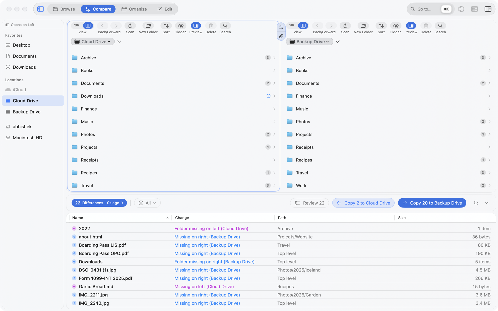
</p>

> **✨ New in v7.1 — Ask Claude remembers.** Past chats are kept on this Mac, Claude keeps notes on
> how you work, simple commands run here without a request to Claude, and Organize's Refine is a
> card in the chat. Press **⌘J** and ask about what's on screen: *"which files are only on
> Dropbox?"*, *"where should this go?"*, *"combine these PDFs"*. Nothing changes until you click
> Apply. [More below](#-ask-claude).

SyncCloud has four workspaces:

- **Browse** — one provider's files, with a Finder-style column view.
- **Compare** — two folders side by side, showing exactly what differs, with one-click copy, move
  and reconcile.
- **Organize** — file loose documents, find duplicates, fix cloud-hostile names, straighten a
  folder tree, and see where the space goes.
- **Edit** — write Markdown and plain text; read, rework, fill in and sign PDFs.

Beside all four sits **Ask Claude** (⌘J). **One-way sync** copies chosen iCloud Drive folders to
Dropbox when you click Sync Now.

Deletes go to the Trash, overwrites are staged and swapped in atomically, and each run is a single
⌘Z.

---

## Features

### 💬 Ask Claude
A chat in a column at the window's right edge (⌘J, or the button at the top right) that answers questions about what you're
looking at and moves you around the app, using your own Anthropic API key. Nothing is sent until
you ask.
- **Sees a description of the screen, not your files** — names, kinds, sizes, dates and tags. When
  a question needs what's inside a file, it's read on this Mac and a card shows exactly what would
  go; nothing from the file is sent until you share it on the card, unless you let it. Names from
  folders you aren't looking at wait on a card too. **Hide from Claude** on any file or folder keeps
  it out.
- **Looks things up and moves your view** — finds files in any source, goes to folders, tabs and
  either side of Compare, and answers *"which files are only on Dropbox?"* from Compare's list,
  selecting the rows it means.
- **Proposes, never acts**: moves, renames, new folders and moves to the Trash arrive as a card you
  apply, with one Undo.
- **Runs the PDF tools**: save as PDF, compress, rotate, clean metadata, add or remove a password,
  take out, delete or reorder pages, split or combine — on a card that says what the new file loses. The original
  never changes, and a password never reaches Claude.
- **Where should this go?** answers from your own folder layout, files a folder's loose files on
  one card, and offers a rule when you correct it or pick another folder. A scan named
  `Scan 0042.pdf` gets a name from its first page, read on this Mac, and a missing year folder is
  made on the same card. **File with Claude** on a row's right-click menu asks it for you.
- **Remembers**: past chats are kept on this Mac for 30 days, searchable behind the clock button,
  and Claude keeps `~/Notes for Claude.md` on your people, folders and how you like answers, written
  only from your own words in the chat.
- **Simple commands run on this Mac**: *"open Settings"*, *"go to Downloads"*, *"show hidden
  files"* run here, with nothing sent and nothing billed. A quiet chip above the text box offers
  to file new downloads or ask about a fresh Compare scan.
- **Right-click ▸ Ask Claude About This** on files, folders and Compare's rows attaches them to
  your question.
- **Changes settings on a card** you click; it changes how the app looks itself, and can lower its
  own spending or access but never raise it. Every change is listed in Activity's Events, most with
  Revert.
- **Type or talk**: click the mic or press ⌥Space; speech becomes text on this Mac. Up brings back
  your last 10 questions.
- **Always at hand**: it is the window's right-hand column, with the content making room, open by
  default once you have saved a key and remembered after that. In a window too narrow to share the
  row it slides over the content instead, and a click there tucks it away.
- Pick Sonnet, Opus or Haiku from the chat; every answer says what it sent and what it cost,
  against a monthly limit ($25 to start).

<p align="center">
  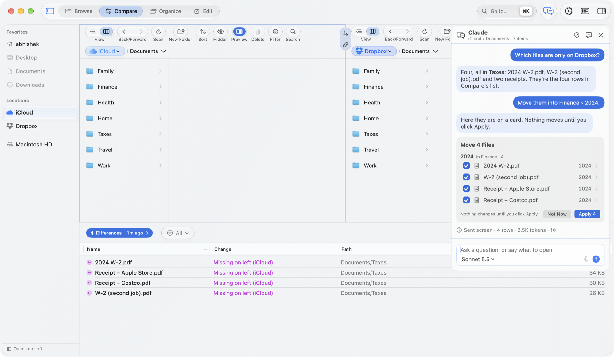
</p>

### 📁 Browse
- **Folder sidebar** (⌃⌘S) in every workspace: **Favorites** you curate, **Locations** for every
  signed-in account and disk, and **Recents** — switchable to **Revisited** (folders you come back
  to) or **Frequent** (where you spend the most time).
- **Column view**, a file preview in each pane's **Info** (⌘I, or ⓘ in the pane bar), per-pane **tabs**, and a
  **pane bar** you arrange yourself.
- **Filter by type** from the pane bar: Images, PDFs, Archives and the rest, with counts.
- **Knows when it's out of date**: a pane says when its folder changed on disk since it was read,
  and an amber line says when Dropbox, OneDrive or Google Drive isn't running and the folder may be
  stale.

### 🔍 Compare
- **Any two providers or folders**, with breadcrumbs, back/forward and one-click ⇄ swap.
- **Diffs by presence, date and size**, with a date tolerance that absorbs cloud timestamp rounding.
- **Coded by color and shape**: missing → / ←, changed ↻, and **name conflicts** ⚠ — names that
  differ only by a trailing space or period, a zero-width character, or Unicode form.
- **Filter and search** (`kind:pdf`, `>10mb`, `only:left`), with live counts.
- **Guided Review** steps through each difference — Copy, Move or Skip.
- **Content verification** checksums same-size pairs to tell you whether they *actually* differ.
- **Keyboard transfers**: ⌘→ / ⌘← copy, add ⇧ to move.
- **One-way sync, iCloud Drive to Dropbox**: set up from Compare, run with **Sync Now**.
  It copies new files, edits, renames, moves and deletions; anything it removes or replaces in
  Dropbox goes to a `SyncCloud Removed` folder, and a file changed directly in Dropbox waits for
  you to choose, unless you set it to use iCloud's version.

### 🗂️ Organize
One provider, seven lenses:
- **To File** — suggests which existing folder each loose file belongs in, and files it there.
- **Duplicates** — identical copies, overlapping folders, drifted versions (`Report (1)`,
  `Report-final`), and PDFs with the same text. Picks a sensible keeper and never trashes the last
  copy.
- **Renames** — names that break on a provider (OneDrive's forbidden characters, Dropbox's trailing
  spaces), plus files that break their folder's own date or numbering convention.
- **Restructure** — finds where a tree disagrees with its own habits (`Form W-2` beside `Form W2`,
  `IRS Docs - 2023` beside `2023`) and turns it into a plan you review step by step. The undo is
  written to disk before anything moves, so it survives a quit.
- **Missing** — the statements each account folder lacks, read from the names of the ones it has
  (`3. Mar 2026.pdf`). It lists the months that never arrived and never moves or fetches a file.
- **Rules** — on-device rules ("when a file matches …, file it into `Taxes/{year}`") with a dry
  run. SyncCloud can learn one from a file you filed by hand.
- **Storage** — a treemap and ranked lists of the largest, oldest and most reclaimable files.
  Read-only: it never moves, deletes or evicts anything.

**Optional AI filing.** Suggestions come from a fast offline engine. You can add **Apple
Intelligence** (on-device) or **Claude** (cloud, opt-in, API key in the Keychain). Claude is used
only when you press **Refine with Claude** and then click **Send** on the plan that appears in the
Ask Claude chat, which shows what goes and what it costs first, on Ask Claude's model and under its
one monthly limit ($25 by default).

### ✏️ Edit — text and Markdown
- **Source, Preview or Split**, with a **format bar** for headings, emphasis, lists, code, links
  and tables. Preview can be typed in too (experimental).
- **Autosaves** a moment after you stop typing, in the file's own encoding; a change made
  elsewhere reloads, or asks if you have unsaved edits.
- **Markdown helpers**: lists continue on Return, pasted links wrap the selection, dropped images
  are saved in the note's `Images` folder, and tables tidy so their pipes line up.
- **Search inside files** — switch the file list's filter to **Contents** to find matching lines,
  plus PDFs, Word and PowerPoint files that contain the word.
- **Typewriter Scrolling**, **Readable Line Length**, a **Paper** background, Go to Line (⌃⌘L),
  and **Expand** (⌃⌘E) to hide everything but the text.
- Opens from any pane (⌘O), from **File ▸ Open Recent**, and from Finder's **Open With**.

<p align="center">
  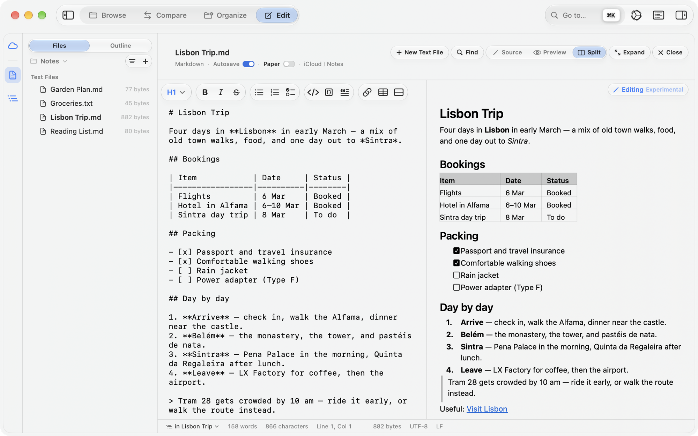
</p>

### 📄 Edit — PDFs
- **Read**: page thumbnails, the outline when a PDF has two or more bookmarks, single or two-page
  layouts, and Find (⌘F).
- **Rework**: rotate, extract, delete and reorder pages; compress; strip metadata; add or remove a
  password. Also on any PDF's right-click menu, for several at once.
- **Fill & Sign**: text, dates, check marks, and a drawn or typed signature kept on this Mac. Real
  form fields fill in their own Tab order and stay fillable. **Replace** retypes a few words in
  their own size, color and font; the old words stay underneath unless you make that page a
  picture.
- **Save as PDF** turns Word, Excel, PowerPoint, RTF, Markdown and plain-text files into PDFs.
- **The original is never modified** — every change writes a new file beside it, such as
  `Lease (signed).pdf`.

<p align="center">
  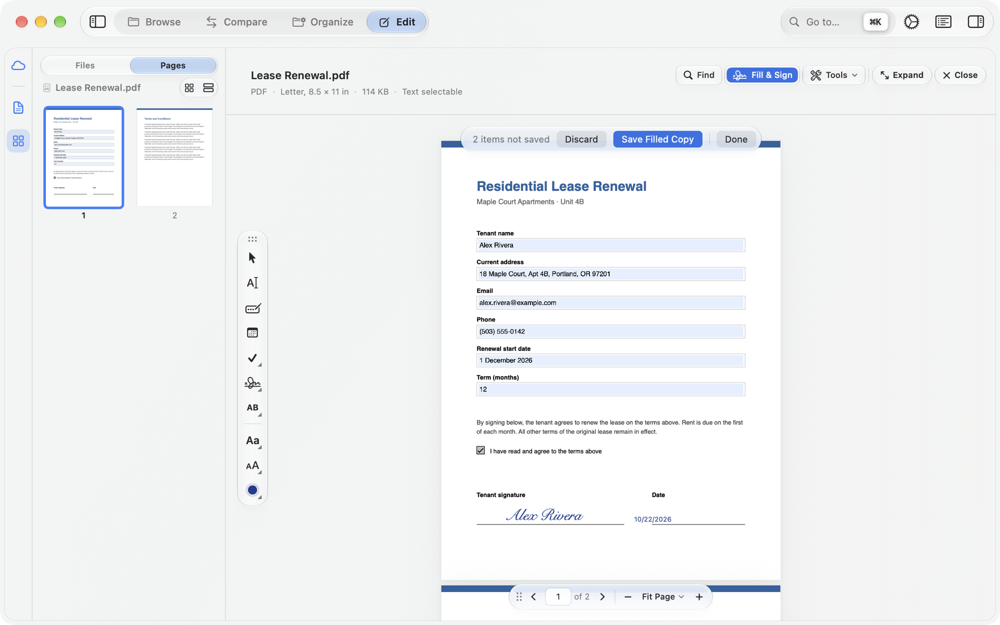
</p>

### 🔐 Vault
A locked panel over the window (**⌘U**, or the lock in the toolbar) for the IDs you get asked
for: a passport number, a member ID, a loan number.
- **Sealed on this Mac**: one encrypted file, its key in your login keychain. Nothing in it is sent
  to Claude or written to the log.
- **Touch ID or your Mac password** to open it. Locked, the panel shows only its lock: no name,
  date or ending, and nothing is read from disk. Unlocked, a row shows a name and the last four
  characters; the full ID is drawn only for the one chosen. A copied ID is cleared from the
  clipboard after a time you set, and the window is kept out of screen sharing while one is shown.
- **Built for a phone call**: type to search, Return to copy, and **Large Type** to read an ID
  out, grouped as its card prints it, with its details under it. A copy clears from the clipboard
  after a minute.
- **Locks itself** when it closes, after a minute with nothing done in it, and when the Mac
  sleeps. **Settings ▸ Vault** changes when it asks, or turns the lock off after one more Touch ID.
- **Cards by kind**: Passports, US Visas, I-94 Records, USCIS Cases, Driver's Licenses, Social
  Security & ITIN, PAN Cards, Aadhaar, Voter IDs, Health & Medical, Utilities & Phone, Loans &
  Mortgage, or one list. Each detail beside an ID (an expiry, a validity's start and end) has its
  own Copy; dates copy as MM/DD/YYYY.
- **Activity** (Settings ▸ Vault): a sealed list of what was unlocked, shown, copied and changed,
  and each proof refused, by ID name and never by number.
- **Backup and restore** (Settings ▸ Vault): a passphrase-sealed backup of every saved ID, by hand
  or weekly, that opens on another Mac. Restoring adds what is missing or replaces the Vault, which
  is set aside first and never deleted. A Vault this Mac can't open offers both ways on.
- **People** (beside Cards and List) groups the same IDs by person: each section opens with the
  name as each document prints it, each spelling marked Legal name, Goes by, Also used or Misread
  (one that looks misread offers Correct to Legal Name), and the date of birth (hidden until one of their IDs is shown),
  each with the ID and document it was read from, so a wrong date can be traced and moved, then their IDs
  under each group, two columns on a wide panel. The Copy menu gives a summary with endings, or every
  ID in full after Touch ID. Rows are marked only for Expired, Expires in N days or To confirm.
- **Card colors**: each card takes a soft tint of its group's color, its title more than its
  rows, so a kind is found by its color. The chosen row is a light lift, not a fill in the
  window's hue. Right-click a card's title and choose Color (or use Color beside Kind): one row of
  colors for that card alone, one for its whole group. Customize Groups turns colors off.
- **Name on the Document**, in Edit, corrects a name a scan misread, for one ID or for every ID
  read with that name and later reads; what was read stays in sight.
- **Correct the ID…**, or a change to the ID in Add to Vault or Edit, fixes a number a scan
  misread. The card keeps a note of what it reads for the ID, so later reads give it to this ID
  even after the card moves, and nothing is set aside everywhere. On this card lists the card's
  other IDs with their labels, an ID already in the Vault can't be added twice, and Undo puts a
  correction back until the Vault locks.
- **Merge…** folds a reading a character or two off into the ID the same person already has, keeping
  whichever number is right; it holds back for different names and for IDs that differ only at the end.
- **Not for This ID**, under a file that names an ID but isn't its own, takes the file off it for
  good, even after the file moves, and reads it again without that ID.
- **More Fields** under a read ID's details lists what its card prints beyond them (RxBIN, RxPCN,
  Payer ID) for Add, or takes one typed with Add a Field…; Edit removes them.
- **Kind** moves an account to another card, or to a kind of your own (New Kind…). A choice for
  an account read from a folder teaches the folder, so its other IDs and later reads follow. An ID
  always shows what it was read as, and As Read puts it back; passports, visas and other checked
  IDs keep their kind.
- **Showing: where, whose, which kinds**: choose the United States or India (a passport shows in both;
  every other ID's country comes from its document), a person, and a group of kinds such as
  Travel & Immigration or Legal & IDs, which you can rename and rearrange. Once chosen, each shrinks
  to one token, and the Vault opens as you left it.
- **Refresh** reads again only the documents your IDs came from: quick, run by itself as the Vault
  opens and after an update, and it marks what changed. A saved ID is never changed for it, and
  an ID is never dropped because its file moved.
- **Discover More** looks in folders you choose for passports (from the photo page, checked
  against its own check digits, with its issue date), visas (US visa foils, OCI cards and e-OCIs,
  and visas granted online such as India's e-Visa), I-94 records and USCIS receipt numbers, and for the
  cards a household files under Legal: US driver's licenses (from the barcode on the back),
  Indian ones, Social Security cards and ITIN notices, PAN, Aadhaar (checked against its check
  digit) and voter IDs. An ID is kept only where its kind can be checked; a misread is
  skipped, never guessed at. Under Health, Home, Vehicles and School it reads account numbers
  (member IDs, utility and phone accounts, loans, policies, VINs checked by their check digit,
  student IDs), opening one paper per account per year, newest first, until two years agree;
  elsewhere only files named as IDs are opened, so a read opens about a tenth of a Documents
  folder. **Current**
  shows one of each kind per person; **Archive** keeps the expired, replaced and archived ones. Each
  ID lists every document that names it, with Quick Look and Reveal in Browse, the one it is read
  from first; where one document is filed twice, Read from This Copy reads it from the other.
  After the first read only new and changed files are opened, and a read goes on when the Vault
  is closed.
- **Is it right?** A To confirm ID has Add to Vault…, Correct the ID… (the document is right,
  the ID taken from it isn't) and Not an ID… side by side. **Tab**, under Used In, says whether an
  ID is Current or in Archive and why; choosing the other moves it, with Undo.
- **Remove** an ID with ⌘⌫, a right-click or Remove… in its editor; the Vault asks first.

### 🧭 Guided setup
A first-run guide reads the folder you point it at — names only, no file is opened — so it can ask
about you and your household with your own folder names in front of you. Nothing is saved until you press
Save. Reopen it from **Help ▸ Set Up SyncCloud…**.

### 🛟 Safe by design
Atomic, backed-up overwrites; Trash-backed deletes; grouped **Undo/Redo**, and **Undo…** on a run in Activity, which lists what it puts back first;
From/To confirmations; collision choices (replace, keep both, skip, or merge folders); and a guard
that refuses an ambiguous path rather than guessing.

### 🎨 Native macOS
**Liquid Glass** (Clear, Frosted or Solid), light and dark themes, 10 accent hues, and
**Settings ▸ Appearance ▸ Text & Spacing** for text size (90–135%) and row spacing.

---

## Screenshots

| Browsing one source | Guided Review | Filing loose files | Finding duplicates |
|---|---|---|---|
| 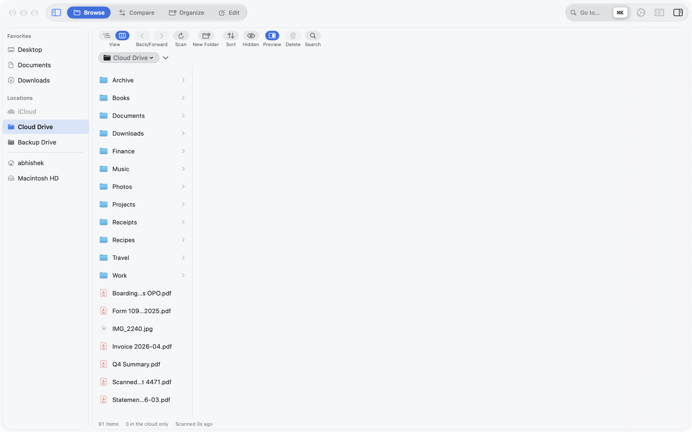 | 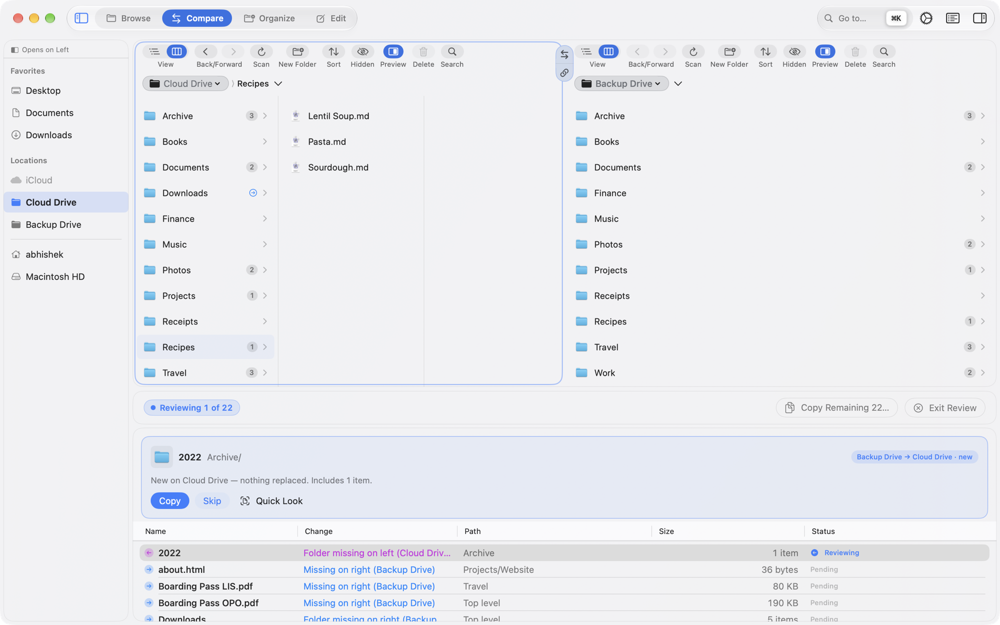 | 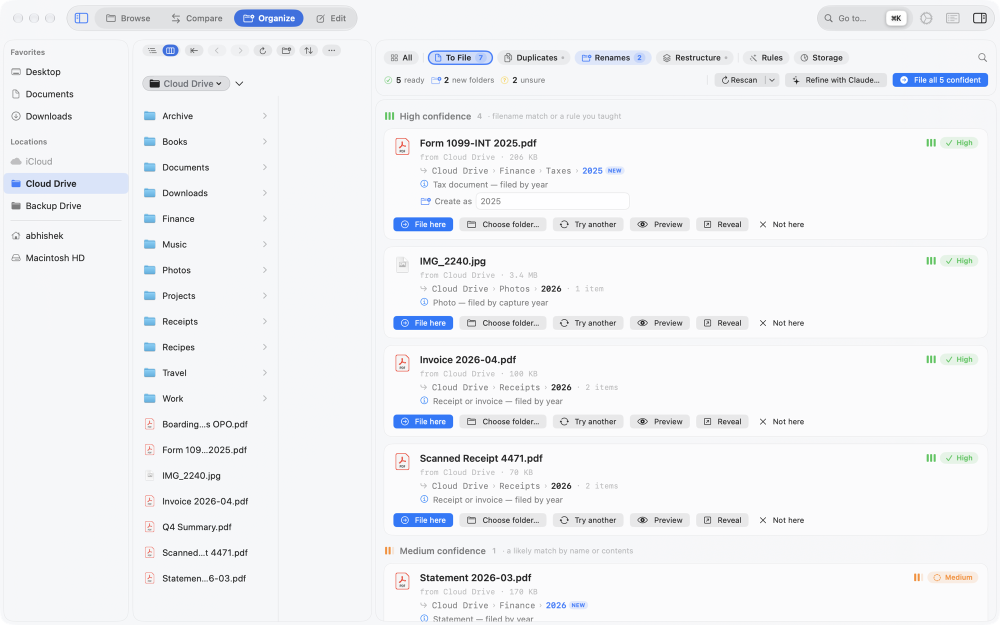 | 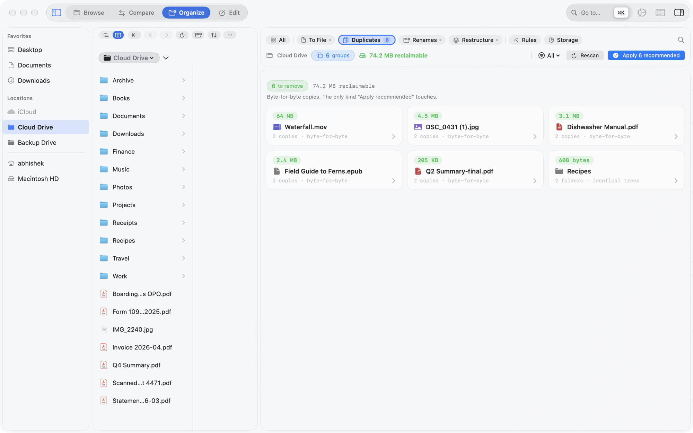 |

| Cloud-hostile names | Storage treemap | Reading a PDF | Settings |
|---|---|---|---|
| 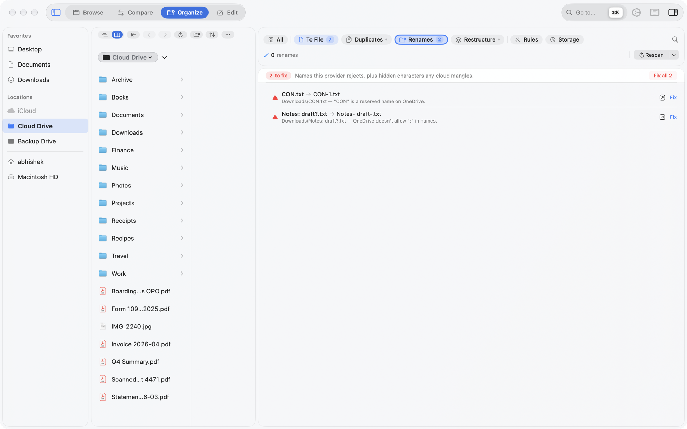 | 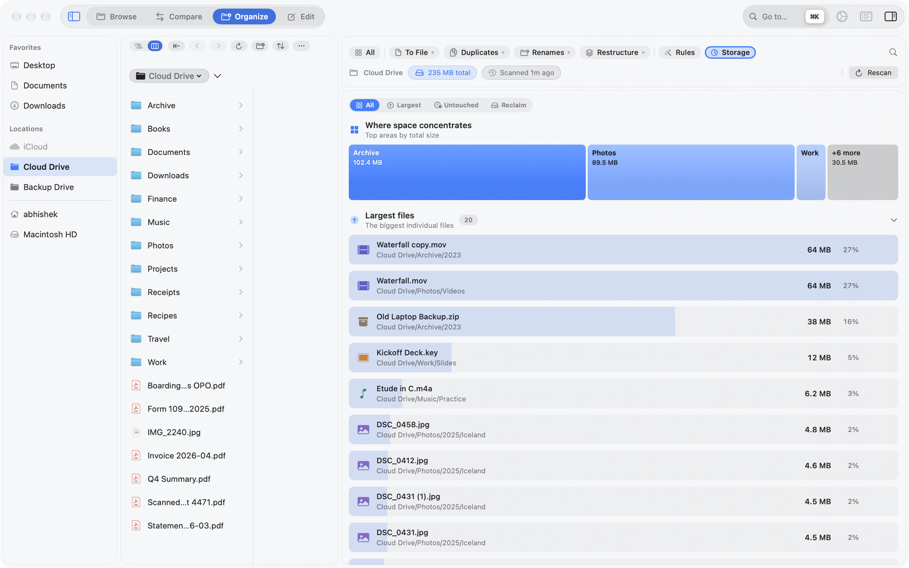 | 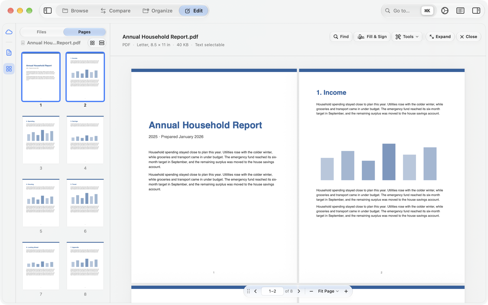 | 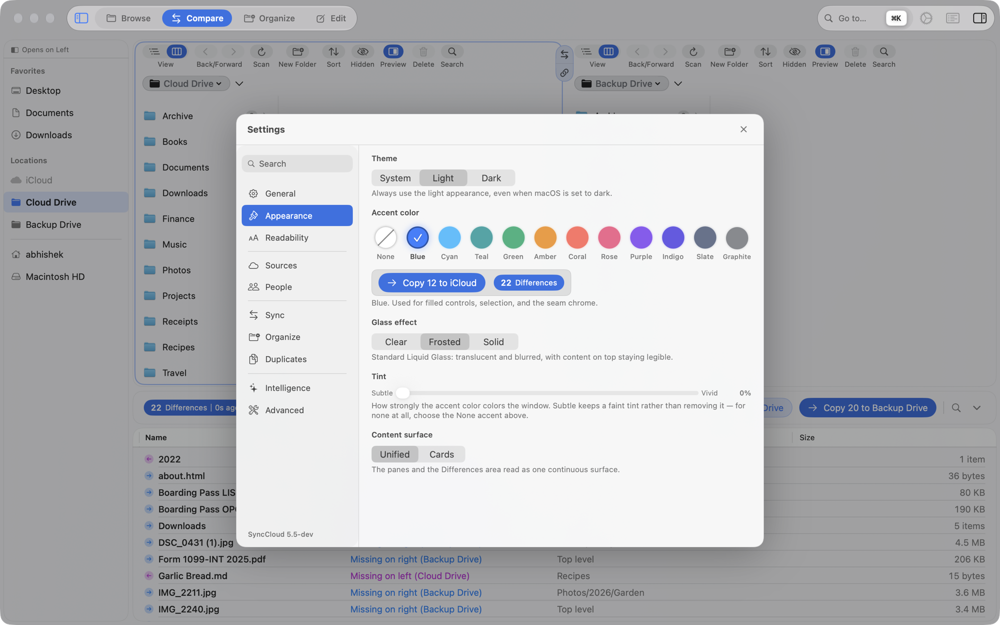 |

Every screenshot is of the app running against a synthetic folder tree.

---

## Requirements

- **macOS 26** or later.
- Optional: **Apple Intelligence** for on-device AI filing; an **Anthropic API key** for Claude.
- To build: **Xcode 26+** (Swift 6) and **[XcodeGen](https://github.com/yonaskolb/XcodeGen)**.

## Building

The Xcode project is generated from `project.yml`:

```bash
brew install xcodegen
xcodegen generate
open SyncCloud.xcodeproj      # then Build & Run (⌘R)
```

## Command line (`synccloud`)

Scan and sync without opening the app. Full docs: [`SyncCloudCLI/README.md`](SyncCloudCLI/README.md).

```bash
cd SyncCloudCLI
swift run synccloud providers                                   # list cloud providers
swift run synccloud scan -L iCloud/Documents -R OneDrive/Documents
swift run synccloud scan -L ~/A -R ~/B --json                   # machine-readable
swift run synccloud sync -L ~/A -R ~/B --direction to-right --strategy keep-both --yes
swift run synccloud restructure                                 # read-only tree report
swift run synccloud missing ~/Documents                         # statements each account lacks
```

Key flags: `--direction auto|to-right|to-left`, `--strategy replace|skip|keep-both`, `--verify`,
`--fail-fast`, `--show-hidden`, `--ignore <path>`, `--json`, `--yes`. Exit codes: `0` success,
`1` partial sync failure, `64` usage error.

## Setting up Claude (optional)

1. Get an API key from the [Claude Console](https://platform.claude.com/settings/keys).
2. In **Settings ▸ Ask Claude ▸ Key & Spending**, paste it under **Claude API key** and press
   **Test**. The key is kept in the Keychain and used by everything below.
3. **Organize's Refine** needs no switch: a saved key turns it on, and each pass shows its price and
   waits for your click. It runs on Ask Claude's model, and Try Another and Refine Names do too.
4. **Ask Claude** (⌘J): pick its model (Sonnet 5.5, Opus 5.5 or Haiku 5.5) and answer style in
   **General**. One **monthly limit** in Key & Spending covers the chat, Refine, Try Another and
   Refine Names.

Without a key, Organize runs on its offline engine, and Ask Claude asks for one before it answers.

## Project structure

```
SyncCloud/
├── MacApp/            # SwiftUI app target
├── Modules/           # Swift packages
│   ├── Sync/          #   diff engine, file operations, filing, duplicates, storage
│   ├── FileExplorer/  #   panes, Compare, Organize lenses, Edit (text and PDF)
│   ├── Dashboard/     #   folder sidebar, activity log, details, history
│   ├── Settings/      #   settings UI and persistence
│   ├── Design/        #   Liquid Glass design system
│   └── Events/        #   logging and sync history
├── SyncCloudCLI/      # the synccloud command-line tool
├── SyncCloudTests/    # app-target tests
├── docs/              # feature site (GitHub Pages) and engineering notes
└── project.yml        # XcodeGen project definition
```

Tests run on every push to `main` on GitHub's hosted runners, and nightly on a self-hosted one
([`docs/ci.md`](docs/ci.md)).
What's planned is in [`ROADMAP.md`](ROADMAP.md).

## License

Provided as-is for educational and personal use.
