# SyncCloud

[](https://github.com/agirish/sync-cloud/actions/workflows/tests.yml)

**A native macOS app, with a `git`-style CLI, for comparing, organizing and editing the files you
keep across iCloud Drive, OneDrive, Dropbox and Google Drive.**

🌐 **[Features and screenshots →](https://agirish.github.io/sync-cloud/)**

<p align="center">
  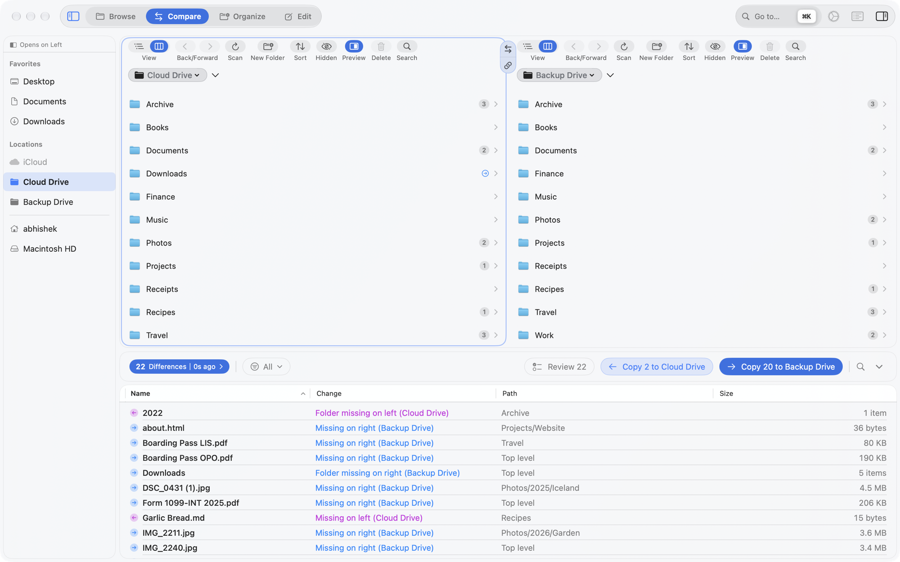
</p>

SyncCloud has four workspaces:

- **Browse** — one provider's files, with a Finder-style column view.
- **Compare** — two folders side by side, showing exactly what differs, with one-click copy, move
  and reconcile.
- **Organize** — file loose documents, find duplicates, fix cloud-hostile names, straighten a
  folder tree, and see where the space goes.
- **Edit** — write Markdown and plain text; read, rework, fill in and sign PDFs.

Deletes go to the Trash, overwrites are staged and swapped in atomically, and each run is a single
⌘Z.

---

## Features

### 📁 Browse
- **Folder sidebar** (⌃⌘S) in every workspace: **Favorites** you curate, **Locations** for every
  signed-in account and disk, and **Recents** — switchable to **Revisited** (folders you come back
  to) or **Frequent** (where you spend the most time).
- **Column view** with an inline preview, per-pane **tabs**, and a **pane bar** you arrange
  yourself.

### 🔍 Compare
- **Any two providers or folders**, with breadcrumbs, back/forward and one-click ⇄ swap.
- **Diffs by presence, date and size**, with a date tolerance that absorbs cloud timestamp rounding.
- **Coded by colour and shape**: missing → / ←, changed ↻, and **name conflicts** ⚠ — names that
  differ only by a trailing space or period, a zero-width character, or Unicode form.
- **Filter and search** (`kind:pdf`, `>10mb`, `only:left`), with live counts.
- **Guided Review** steps through each difference — Copy, Move or Skip.
- **Content verification** checksums same-size pairs to tell you whether they *actually* differ.
- **Keyboard transfers**: ⌘→ / ⌘← copy, add ⇧ to move.

### 🗂️ Organize
One provider, six lenses:
- **To File** — suggests which existing folder each loose file belongs in, and files it there.
- **Duplicates** — identical copies, overlapping folders, drifted versions (`Report (1)`,
  `Report-final`), and PDFs with the same text. Picks a sensible keeper and never trashes the last
  copy.
- **Renames** — names that break on a provider (OneDrive's forbidden characters, Dropbox's trailing
  spaces), plus files that break their folder's own date or numbering convention.
- **Restructure** — finds where a tree disagrees with its own habits (`Form W-2` beside `Form W2`,
  `IRS Docs - 2023` beside `2023`) and turns it into a plan you review step by step. The undo is
  written to disk before anything moves, so it survives a quit.
- **Rules** — on-device rules ("when a file matches …, file it into `Taxes/{year}`") with a dry
  run. SyncCloud can learn one from a file you filed by hand.
- **Storage** — a treemap and ranked lists of the largest, oldest and most reclaimable files.
  Read-only: it never moves, deletes or evicts anything.

**Optional AI filing.** Suggestions come from a fast offline engine. You can add **Apple
Intelligence** (on-device) or **Claude** (cloud, opt-in, API key in the Keychain). Claude is used
only when you press **Refine with Claude**, with a cost estimate first and monthly and lifetime
budget caps ($5 lifetime by default).

### ✏️ Edit — text and Markdown
- **Source, Preview or Split**, with a **format bar** for headings, emphasis, lists, code, links
  and tables. Preview can be typed in too (experimental).
- **Autosaves** a moment after you stop typing, in the file's own encoding; a change made
  elsewhere reloads, or asks if you have unsaved edits.
- **Markdown helpers**: lists continue on Return, pasted links wrap the selection, dropped images
  are saved in the note's `Images` folder, and tables tidy so their pipes line up.
- **Search inside files** — switch the file list's filter to **Contents** to find matching lines,
  plus PDFs, Word and PowerPoint files that contain the word.
- **Typewriter Scrolling**, **Readable Line Length**, a **Paper** background, Go to Line (⌃⌘L),
  and **Expand** (⌃⌘E) to hide everything but the text.
- Opens from any pane (⌘O), from **File ▸ Open Recent**, and from Finder's **Open With**.

<p align="center">
  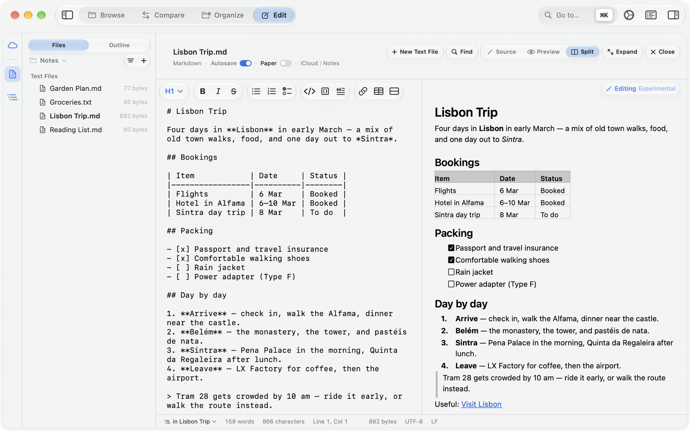
</p>

### 📄 Edit — PDFs
- **Read**: page thumbnails, the outline, single or two-page layouts, and Find (⌘F).
- **Rework**: rotate, extract, delete and reorder pages; compress; strip metadata; add or remove a
  password. Also on any PDF's right-click menu, for several at once.
- **Fill & Sign**: text, dates, check marks, and a drawn or typed signature kept on this Mac. Real
  form fields fill in their own Tab order and stay fillable. **Replace** retypes a few words in
  their own size, colour and font; the old words stay underneath unless you make that page a
  picture.
- **Save as PDF** turns Word, Excel, PowerPoint, RTF, Markdown and plain-text files into PDFs.
- **The original is never modified** — every change writes a new file beside it, such as
  `Lease (signed).pdf`.

<p align="center">
  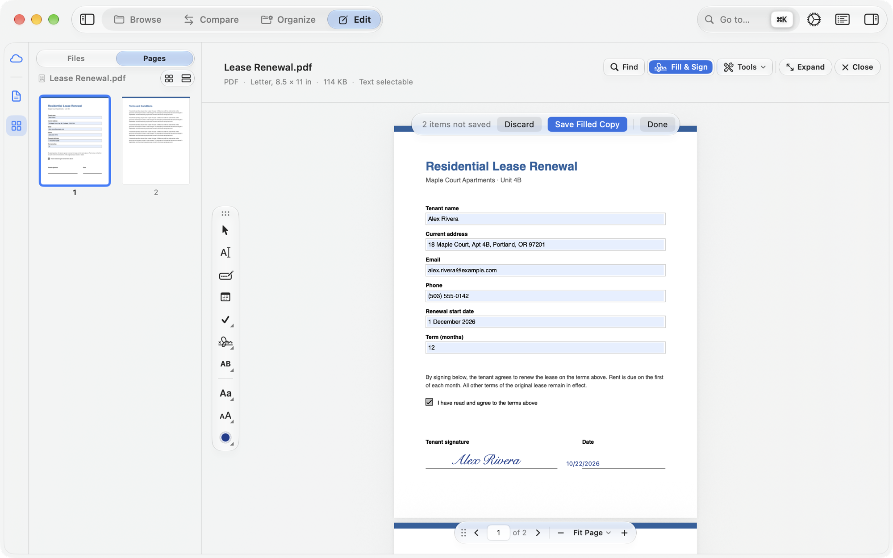
</p>

### 🧭 Guided setup
A first-run guide reads the folder you point it at — names only, no file is opened — so it can ask
about you and your household with your own folder names in front of you. Nothing is saved until you press
Save. Reopen it from **Help ▸ Set Up SyncCloud…**.

### 🛟 Safe by design
Atomic, backed-up overwrites; Trash-backed deletes; grouped **Undo/Redo** and **Undo Last Run**;
From/To confirmations; collision choices (replace, keep both, skip, or merge folders); and a guard
that refuses an ambiguous path rather than guessing.

### 🎨 Native macOS
**Liquid Glass** (Clear, Frosted or Solid), light and dark themes, 11 accent hues, and
**Settings ▸ Readability** for text size (90–135%) and row spacing.

---

## Screenshots

| Browsing one source | Guided Review | Filing loose files | Finding duplicates |
|---|---|---|---|
| 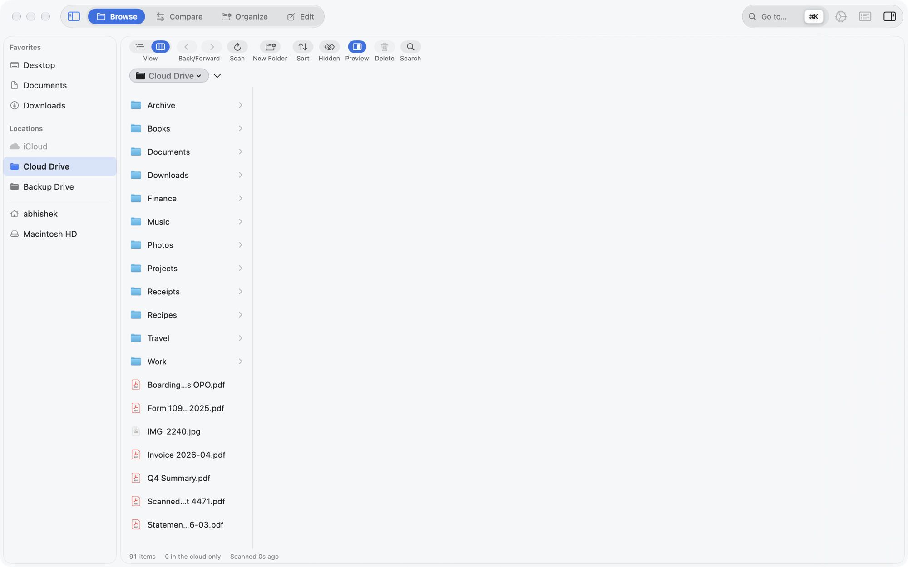 | 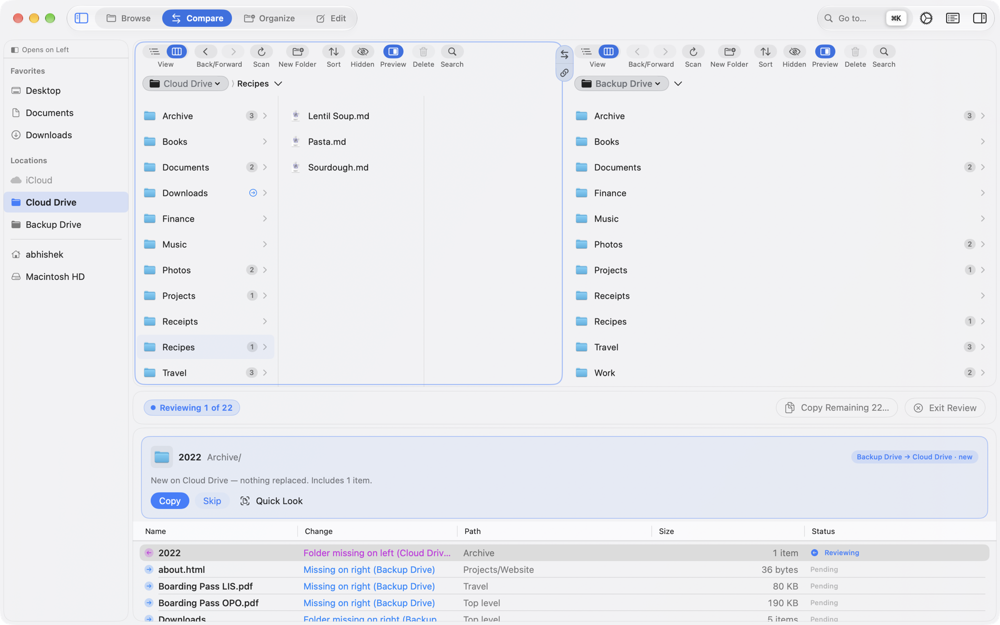 | 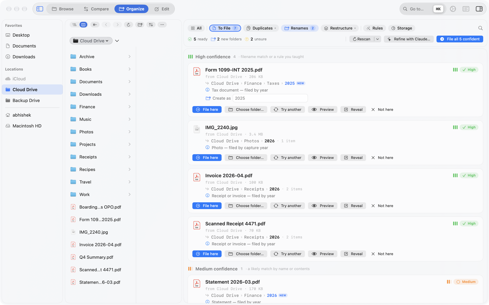 | 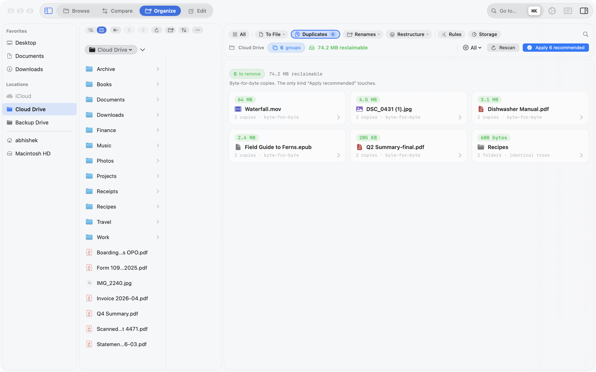 |

| Cloud-hostile names | Storage treemap | Reading a PDF | Settings |
|---|---|---|---|
| 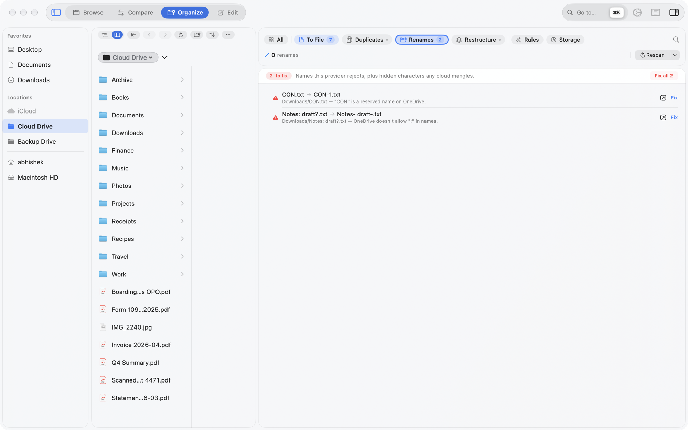 | 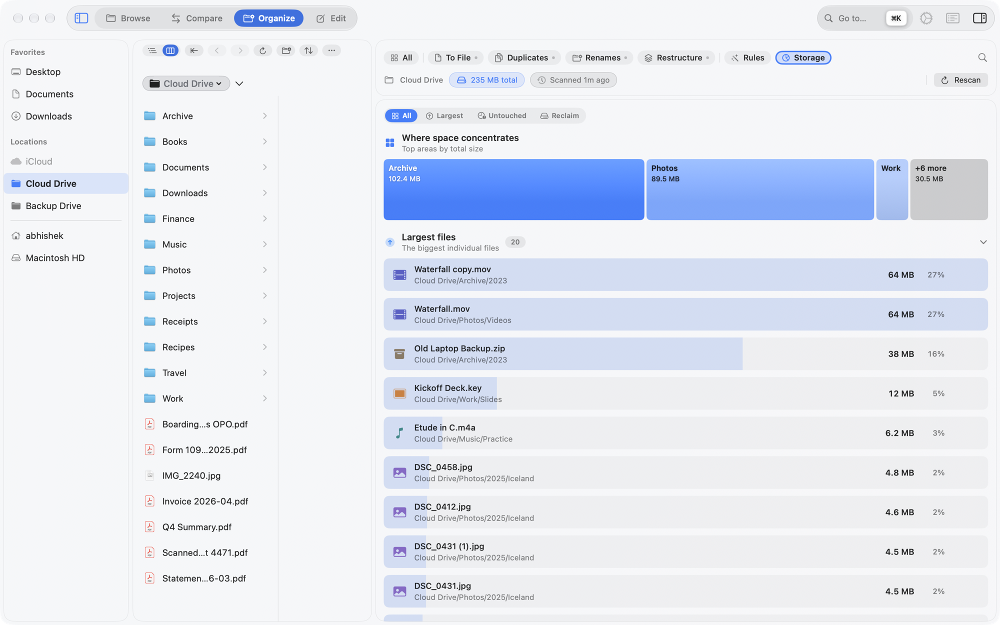 | 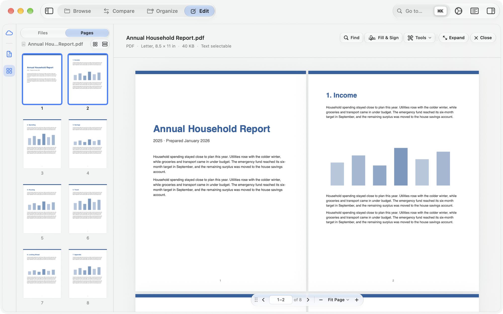 | 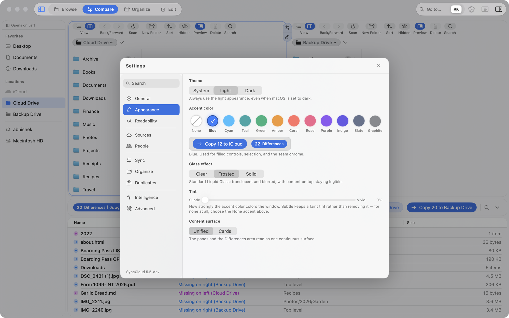 |

Every screenshot is of the app running against a synthetic folder tree.

---

## Requirements

- **macOS 26** or later.
- Optional: **Apple Intelligence** for on-device AI filing; an **Anthropic API key** for Claude.
- To build: **Xcode 26+** (Swift 6) and **[XcodeGen](https://github.com/yonaskolb/XcodeGen)**.

## Building

The Xcode project is generated from `project.yml`:

```bash
brew install xcodegen
xcodegen generate
open SyncCloud.xcodeproj      # then Build & Run (⌘R)
```

## Command line (`synccloud`)

Scan and sync without opening the app. Full docs: [`SyncCloudCLI/README.md`](SyncCloudCLI/README.md).

```bash
cd SyncCloudCLI
swift run synccloud providers                                   # list cloud providers
swift run synccloud scan -L iCloud/Documents -R OneDrive/Documents
swift run synccloud scan -L ~/A -R ~/B --json                   # machine-readable
swift run synccloud sync -L ~/A -R ~/B --direction to-right --strategy keep-both --yes
swift run synccloud restructure                                 # read-only tree report
```

Key flags: `--direction auto|to-right|to-left`, `--strategy replace|skip|keep-both`, `--verify`,
`--fail-fast`, `--show-hidden`, `--ignore <path>`, `--json`, `--yes`. Exit codes: `0` success,
`1` partial sync failure, `64` usage error.

## Setting up Claude (optional)

1. Get an API key from the [Anthropic Console](https://console.anthropic.com/).
2. In **Settings ▸ Intelligence**, turn on *Use Claude (cloud)*, paste the key, pick a model
   (Haiku 4.5, Sonnet 5 or Opus 5) and press **Test**.
3. Set a monthly or lifetime **budget cap**.

Without a key, Organize runs on its offline engine.

## Project structure

```
SyncCloud/
├── MacApp/            # SwiftUI app target
├── Modules/           # Swift packages
│   ├── Sync/          #   diff engine, file operations, filing, duplicates, storage
│   ├── FileExplorer/  #   panes, Compare, Organize lenses, Edit (text and PDF)
│   ├── Dashboard/     #   folder sidebar, activity log, details, history
│   ├── Settings/      #   settings UI and persistence
│   ├── Design/        #   Liquid Glass design system
│   └── Events/        #   logging and sync history
├── SyncCloudCLI/      # the synccloud command-line tool
├── SyncCloudTests/    # app-target tests
├── docs/              # feature site (GitHub Pages) and engineering notes
└── project.yml        # XcodeGen project definition
```

Tests run on every push via a self-hosted GitHub Actions runner ([`docs/ci.md`](docs/ci.md)).
What's planned is in [`ROADMAP.md`](ROADMAP.md).

## License

Provided as-is for educational and personal use.
